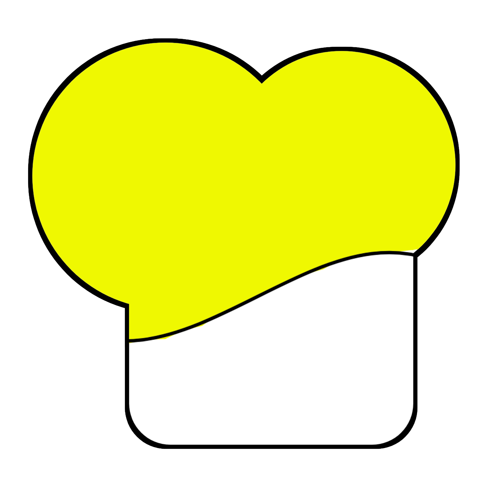

<div align="center">



# DeoChef

**A touch-first Android photo editor with editable `.deoc` projects.**

[](../../releases/latest)

[View all releases](../../releases)

</div>

> **Project status: early prototype.** This build establishes DeoChef’s mobile editing workflow and native project format; it is not yet a Advanced one and equivalent.

## About DeoChef

DeoChef is an Android-first photo-editing project built with Kotlin and Jetpack Compose. Its interface keeps the canvas and common actions close at hand, while grouping editing tools into compact panels. The design takes inspiration from the approachable, canvas-first workflows of mobile editors such as [PixelLab](https://play.google.com/store/apps/details?id=com.imaginstudio.imagetools.pixellab&hl=en_US), with room to grow toward more advanced desktop-class editing capabilities.

## What works in this build

- Open a photo from Android’s document picker or create a blank portrait canvas.
- Adjust exposure, contrast, saturation, and warmth with nondestructive on-screen controls.
- Apply centered crop presets (original, 1:1, 4:5, 9:16, or 16:9) and rotate in 90-degree steps.
- Add and move editable text, circle, rectangle, and simple sparkle objects; select, recolor, and delete layers.
- Undo and redo recorded changes.
- Export flattened PNG, high-quality JPEG, or single-page raster PDF files.
- Save and reopen editable **`.deoc` v1** projects containing the source image and project settings.
- Keep photo processing local to the device; this build does not upload photos.

## File support

| Format | Current support |
|---|---|
| JPEG, PNG, WebP | Import when supported by the Android image decoder |
| `.deoc` | DeoChef editable project; ZIP container with `project.json`, the original image at `source/original`, and a format note |
| PNG, JPEG | Flattened image export |
| PDF | Single-page raster export, not a CMYK or print-prepress PDF |
| PSD, AI, EPS, TIFF | **Not implemented**; no layered import or round-trip support is claimed |

The `.deoc` project preserves its supported adjustment values, crop/rotation settings, and editable text/shape layers. It is a versioned DeoChef working format, not an interchange format for Photoshop or Affinity documents. The current editing session has no project library or automatic save, so save the `.deoc` file explicitly.

## Current limitations

This prototype does not yet include brush or eraser engines, selections or masks, blend modes, adjustment layers, curves/levels, clone/heal, vector path editing, background removal, perspective warp, RAW processing, color-profile/CMYK workflows, or professional typography management. Crop is limited to centered presets, and shape and text tools remain basic. Imported images are decoded to a working bitmap capped at roughly 5,000 pixels on the longest side to manage mobile memory; source dimensions above that are not guaranteed in exports.

## Build

Requirements: JDK 17+, Android SDK Platform 34 and Build Tools 34+, and the Gradle dependencies declared by the project.

```bash
ANDROID_HOME=/path/to/Android/Sdk \
ANDROID_SDK_ROOT=/path/to/Android/Sdk \
./gradlew assembleDebug
```

The installable debug APK is written to `app/build/outputs/apk/debug/app-debug.apk`. To build the optimized release variant:

```bash
ANDROID_HOME=/path/to/Android/Sdk \
ANDROID_SDK_ROOT=/path/to/Android/Sdk \
./gradlew assembleRelease
```

The release variant enables R8 and resource shrinking, but the resulting APK is **unsigned** until a release signing configuration is supplied. The verified build artifacts from this prototype are approximately 55 MB (debug) and 2.9 MB (unsigned optimized release). The debug APK is larger because it packages the extended Compose Material icon library without release shrinking. Package size is not padded to meet an arbitrary target; real brushes, LUTs, textures, RAW profiles, and other licensed content can be added as they are implemented.

## Branding

The repository’s DeoChef logo is referenced as `deochef.png`. The Android project also uses the supplied launcher icon, wordmark, organization mark, Folklore brand font, and iOS Semibold interface font. Original supplied assets are retained under `app/src/main/assets/brand/source/`.

## Roadmap

1. Improve undo/history reliability, recovery, document naming, and canvas sizing.
2. Expand typography and layer controls, blending/opacity, brush/selection foundations, and richer vector tools.
3. Design and validate additional interchange formats individually; only advertise formats with working parsers and round-trip tests.
4. Add high-resolution and color-managed export, real-device memory/performance testing, accessibility, and localization.

The project license and third-party asset licensing should be established before public distribution.
